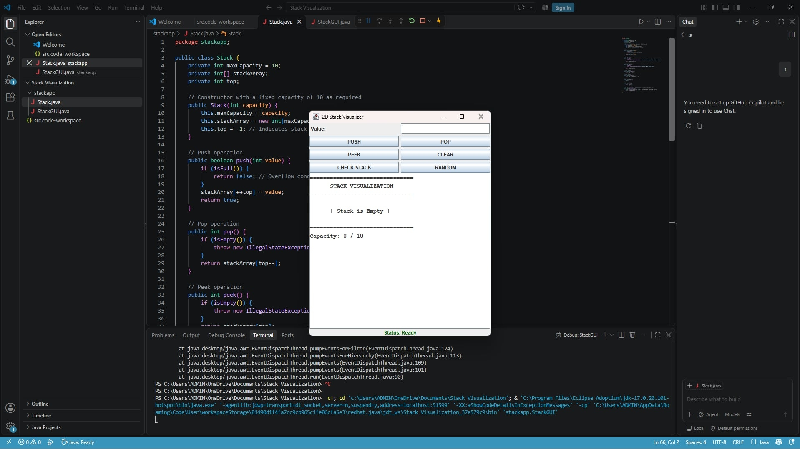

2D Stack Visualizer

Group Name
Group 5

Group Members: 
Mariano Gellan V,
Nerie Bayking,
Ray Sibal,
Manlangit Jerremin


Description of the Program
The 2D Stack Visualizer is a Java-based desktop application designed to demonstrate the fundamental principles of a Last-In, First-Out (LIFO) linear data structure. The program cleanly separates the core data structure logic from the graphical user interface (GUI). It provides an interactive 2D graphical representation of a bounded, array-based stack, allowing users to perform and visualize standard stack operations in real-time alongside clear status messages and error handling (such as Stack Overflow and Stack Underflow notifications).


Features
Interactive Stack Operations: 
Push: Adds a value to the top of the stack (bounded to a maximum capacity of 10 elements).

Pop: Removes and returns the top element from the stack.

Peek: Examines and displays the top element without modifying or removing it.

Clear: Resets and empties the entire stack.
Check Stack: Displays the current status of the stack (whether it is empty or active).

Random: Clears the current stack and automatically generates a random number of elements (between 1 and maximum capacity), with each element holding a random integer from 1 to 100.

Real-Time Visual Updates: The GUI visually reflects the current state of the stack after every operation, clearly highlighting the top element.

Error Handling: Displays descriptive status messages for boundary conditions like `STACK OVERFLOW` and `STACK UNDERFLOW`.


Requirements
Java Development Kit (JDK): Version 17 or higher recommended.

Git: For version control and repository synchronization.

IDE / Environment: Visual Studio Code, Eclipse, or IntelliJ IDEA with Java extensions enabled.


How to Run the Program
1. Clone the Repository:
   ```bash
   git clone [https://github.com/notgell/stack-visualization-group-5.git](https://github.com/notgell/stack-visualization-group-5.git)


Navigate to the Project Directory 

- Bash
cd stack-visualization-group-5

Compile And Run
- Open the project in your preferred Java-supported IDE (e.g., VS Code or Eclipse).

- Locate the main execution file (StackGUI.java or your main launcher).

- Run the application.


stack-visualization-group-5/
│
└── src/
    └── stackapp/
        ├── Stack.java       # Core stack data structure logic (LIFO, array-based, capacity = 10)
        └── StackGUI.java    # Graphical User Interface and event handling using Java Swing/AWT


Stack Implementation
Data Structure Type: Array-based bounded stack.

Maximum Capacity: 10 elements.

Core Methods:

push(int value): Inserts an element at the top if the stack is not full. Returns true on success, or handles overflow condition.

pop(): Removes and returns the top element if the stack is not empty; throws an exception / displays underflow otherwise.

peek(): Returns the top element without removing it.

isEmpty(): Checks if the stack contains no elements.

isFull(): Checks if the stack has reached its maximum capacity of 10.


Screenshot




AI Disclosure Statement
AI Tool Used: OpenAI Chat GPT

Task Performed: Assisted with code drafting, debugging guidance, and documentation structuring.

Prompts Used: Prompts relating to Java Swing GUI layout coordination and array-based stack implementation logic.

Extent of Use: Substantial drafting and code review assistance.

Human Verification: All AI-generated code and outputs were thoroughly reviewed, tested, verified, and modified by human group members to ensure complete understanding and functional correctness.

Percentage of AI Assistance: Estimated at ~50% (primarily formatting, syntax check, and boilerplate GUI structuring).

